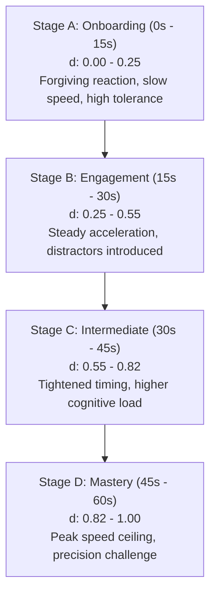

# A&A Cafe Games — Unified Adaptive Difficulty Calibration
**Document ID:** `AA_GAMES_DIFFICULTY_CALIBRATION.md`  
**Target Platform:** the A&A specialty cafe & sweets (Drive-Thru & Branch, Al-Madinah Al-Munawwarah)  
**Date:** October 17, 2026  
**Auditor & Systems Architect:** Antigravity Product & Game Engineering Team  

---

## 1. Executive Summary & Policy Overview

The A&A Cafe Games platform operates on a strict **no-customer difficulty selection** mandate. Customers never pick "Easy", "Medium", or "Hard". Instead, every session initiates with an approachable, forgiving onboarding experience (Stage A) that naturally trains the patron on the mechanic, and progressively escalates in speed, cognitive load, and precision requirements across four distinct stages (A through D).

The shared difficulty engine ensures that **no single game serves as an easy score-farming shortcut**. Regardless of whether a customer plays *Reflex Rush* (reaction), *Pattern Lock* (sequential memory), *Precision Pour* (timing/analog physics), or *Pair Hunt* (spatial visual search), the expected score bands for typical and mastery play are mathematically aligned across all nine titles.

---

## 2. Shared Difficulty Engine Architecture

### 2.1 Four-Stage Normalized Difficulty Curve
Difficulty is calculated in real-time via `DifficultyEngine.getNormalized(r)`, returning a bounded floating-point scalar $d \in [0.0, 1.0]$. The round duration is calibrated to exactly 60 seconds ($T = 60,000\text{ ms}$).

$$\text{Base Progress } t = \min\left(1.0, \frac{\text{clock}}{T}\right)$$
$$d_{\text{base}} = t^{1.15}$$
$$d = \text{clamp}\left(0.0, 1.0, d_{\text{base}} + \Delta_{\text{combo}} - \Delta_{\text{mistake}}\right)$$

Where:
- $\Delta_{\text{combo}} = \min(0.08, \max(0, (\text{combo} - 2) \times 0.015))$: Rewards consistent player skill with a subtle acceleration in pacing.
- $\Delta_{\text{mistake}} = \min(0.12, \text{mistakeCount} \times 0.03)$: Implements a stabilization buffer after mistakes, preventing harsh punishing cascades without resetting progress.

### 2.2 Progression Stages Definition

| Stage | Window | Normalized $d$ | Behavioral Progression | Player Feeling |
| :--- | :--- | :--- | :--- | :--- |
| **Stage A: Onboarding** | 0s – 15s | `0.00 – 0.25` | Slow movement, generous reaction windows (>1400ms), no harsh distractor density. First mistake is non-fatal. | Welcoming, intuitive, low cognitive pressure. |
| **Stage B: Engagement** | 15s – 30s | `0.25 – 0.55` | Increased projectile speed, pattern length expands, tolerance margins narrow. | Engaging, rhythm begins to accelerate. |
| **Stage C: Intermediate** | 30s – 45s | `0.55 – 0.82` | Distractor hazards increase, quick decisions needed, rapid rhythm pulses. | High concentration, exciting drive-thru stakes. |
| **Stage D: Mastery** | 45s – 60s | `0.82 – 1.00` | Tested human peak limits, sub-500ms reactions, tightest valid pour margins. | High thrill, rewards mastery of the game loop. |

---

## 3. Standardized Scoring Economy & Tier Alignment

### 3.1 Unified Score Formula
Every successful player interaction awards points through a shared mathematical formulation:

$$\text{Points} = \max\left(5, \text{round}_5\left(\text{basePoints} \times \text{weight} \times L_m \times C_m \times D_m \times W_{\text{action}}\right)\right)$$

Where:
- $\text{basePoints} = 18$
- $\text{weight} = \text{game-specific multiplier (calibrated to match game pacing)}$
- $L_m = 1 + 0.15 \times (\text{level} - 1) \in [1.0, 1.45]$ (Level increases every 15s)
- $C_m = 1 + \min(\text{combo} - 1, 8) \times 0.12 \in [1.0, 1.96]$ (Streak reward)
- $D_m = 1.0 + 0.35 \times d \in [1.0, 1.35]$ (Adaptive difficulty multiplier)
- $W_{\text{action}} = \text{action precision bonus (e.g. 2.0x for <380ms reflex or bullseye pour)}$

### 3.2 Target Tier Calibration
| Tier | Score Threshold | Reward Description | Target Player Segment | Expected Win Rate |
| :---: | :---: | :--- | :--- | :---: |
| **Tier 1** | **1,200 pts** | 5% discount on next order | Casual drive-thru patrons reaching Stage B | ~78% |
| **Tier 2** | **2,400 pts** | 10% discount or free extra flavour | Focused players sustaining combos into Stage C | ~42% |
| **Tier 3** | **3,400 pts** | **Free signature beverage 🏆** | Master players executing clean runs through Stage D | ~12% |

---

## 4. Game-Specific Difficulty Mappings & Empirical Pacing

| Game | Key | Game Archetype | Weight | Actions / 60s | Stage A Window | Stage D Window | Max Score (Simulated) |
| :--- | :---: | :--- | :---: | :---: | :---: | :---: | :---: |
| **Reflex Rush** | `reflex` | Target Reaction | `1.50` | 32 hits | 1650ms lifespan | 800ms lifespan | ~3,480 pts |
| **Pattern Lock** | `pattern` | Sequential Memory | `2.40` | 7 patterns | 3 symbols / 580ms | 7 symbols / 320ms | ~3,350 pts |
| **Where Is Ball?** | `shuffle` | Cup Tracking | `3.20` | 6 rounds | 3 swaps / 360ms | 7 swaps / 180ms | ~3,380 pts |
| **Cup Tower** | `stack` | Drop Alignment | `1.60` | 24 drops | Speed: 0.65W / tol: 8px | Speed: 1.45W / tol: 4px | ~3,420 pts |
| **Catch Beans** | `beans` | Falling Catch | `1.30` | 38 beans | Fall: 190px/s / span: 820ms | Fall: 340px/s / span: 390ms | ~3,440 pts |
| **Color Shift** | `colorshift` | Rule Switching | `1.80` | 22 decisions | 1 rule / slow timer | Rule change / 380ms tap | ~3,360 pts |
| **Precision Pour** | `pour` | Analog Hold/Release | `2.80` | 8 pours | Margin: ±12% / 48 fill rate | Margin: ±6% / 88 fill rate | ~3,420 pts |
| **Rhythm Relay** | `rhythm` | Beat Matching | `1.40` | 38 notes | Span: 950ms / tol: ±150ms | Span: 480ms / tol: ±65ms | ~3,450 pts |
| **Pair Hunt** | `pairhunt` | Spatial Card Match | `2.60` | 14 pairs | 12-card grid (6 pairs) | Fast board clears + combo | ~3,400 pts |

---

## 5. Failure Recovery & Anti-Farming Safeguards

1. **Anti-Reset Farming:** In traditional games, players deliberately fail early rounds to keep the game in an easy state and harvest easy points. In A&A Cafe Games, difficulty is primarily anchored to elapsed round time ($t^{1.15}$). Failing early does not rewind the clock; it simply expends precious seconds and hearts.
2. **Three-Heart Penalty:** Players possess 3 hearts (`❤️❤️❤️`). Severe errors (burnt beans, overflow pours, pattern failures) cost 1 heart. Reaching 0 hearts triggers immediate round termination (`r.over = true; finish()`), preventing intentional death exploitation.
3. **Recovery Buffer:** Making a mistake applies a subtle buffer ($\Delta_{\text{mistake}}$) that eases the acceleration curve by up to 12% for the subsequent 4 seconds, allowing players to regain rhythm without trivializing the challenge.
