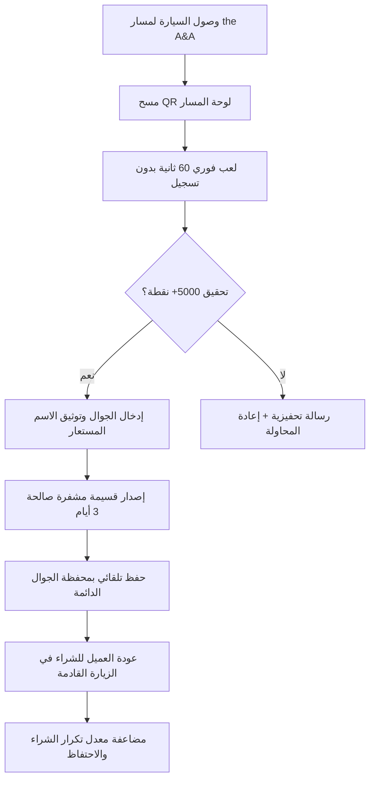
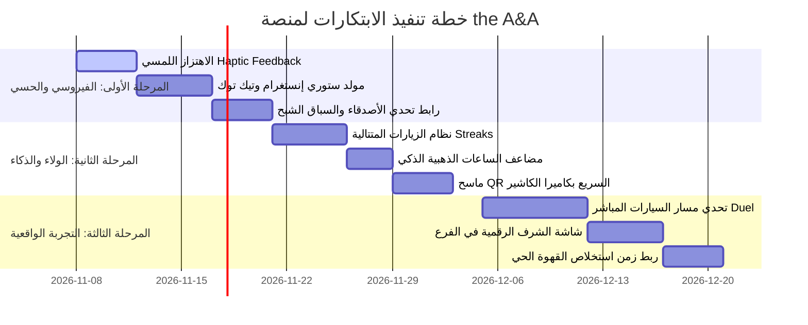

# وثيقة استراتيجية الابتكار والنمو الفيروسي لمنصة ألعاب كافيه the A&A
**the A&A Specialty Cafe & Sweets — Al-Madinah Al-Munawwarah**  
*إصدار المخطط الاستراتيجي والتطويري: نوفمبر 2026*

---

## 📌 الفهرس التنفيذي
1. [الرؤية الاستراتيجية والميزة التنافسية غير القابلة للتقليد](#1-الرؤية-الاستراتيجية-والميزة-التنافسية)
2. [المحور الأول: ابتكارات مسار السيارات الواقعية (Phygital Drive-Thru Mechanics)](#2-المحور-الأول-ابتكارات-مسار-السيارات-الواقعية)
3. [المحور الثاني: هندسة الانتشار الفيروسي والسوشيال ميديا (Viral Loops & Social Bragging)](#3-المحور-الثاني-هندسة-الانتشار-الفيروسي)
4. [المحور الثالث: اقتصاد الولاء والاحتفاظ الذكي بالعملاء (Gamified Retention & Dynamic Yield)](#4-المحور-الثالث-اقتصاد-الولاء-والاحتفاظ-الذكي)
5. [المحور الرابع: الابتكارات الحسية والتجربة الغامرة (Sensory ASMR & Haptic Feedback)](#5-المحور-الرابع-الابتكارات-الحسية-والتجربة-الغامرة)
6. [المحور الخامس: ذكاء العمليات وبوابة الكاشير الذكية (Staff Operations & Business Intelligence)](#6-المحور-الخامس-ذكاء-العمليات-وبوابة-الكاشير)
7. [النمذجة الرياضية لنمو الإيرادات (Financial & Unit Economics Modeling)](#7-النمذجة-الرياضية-لنمو-الإيرادات)
8. [خارطة الطريق الزمنية للتنفيذ (3-Phase Execution Roadmap)](#8-خارطة-الطريق-الزمنية-للتنفيذ)

---

## 1. الرؤية الاستراتيجية والميزة التنافسية

### تشخيص واقع سوق القهوة المختصة في المملكة:
- **المنافسون التقليديون** (هاف مليون، بارنز، أوفر دوز، دكتور كافيه، دانكن) يعتمدون جميعاً على نفس النموذج النمطي الميت:
  - تطبيق جوال بحجم 80–120 ميجابايت يتطلب تحميلاً من المتجر.
  - تسجيل معقد برقم الجوال ورمز تحقق OTP.
  - جمع نقاط روتيني وممل بعد الدفع فقط.
- **الفرصة المهدرة في مسار السيارات (Drive-Thru Bottleneck):**
  - العميل يقضي في مسار السيارات ما بين **3 إلى 6 دقائق** بانتظار تحضير القهوة والحلويات.
  - هذا "الوقت الميت" يمثل أعلى درجات الملل للعميل، لكنه في الحقيقة **أعلى نافذة تركيز وانتباه (High-Attention Window) يمكن استغلالها**.

### الميزة الفريدة لمنصة the A&A:
1. **صفر احتكاك (Zero-Friction PWA):** مسح كود QR من لوحة المسار يفتح اللعبة خلال 0.8 ثانية بدون أي تحميل أو تثبيت.
2. **لعب فوري مباشر (Instant Play):** لا حواجز تسجيل عند الدخول؛ اللعب أولاً، والمتعة أولاً.
3. **اقتصاد المكافأة المقيدة بالزيارة القادمة (Next-Order Locked Incentive):** الكوبون لا يُصرف لنفس الطلب الحالي، بل يضمن عودة العميل بنسبة 100% خلال نافذة 72 ساعة، مما يرفع القيمة الدائمة للعميل (LTV) بشكل مضاعف.



---

## 2. المحور الأول: ابتكارات مسار السيارات الواقعية

### أ. تحدي سيارة ضد سيارة مباشر (Live Drive-Thru Lane Duel 🏎️⚔️)
- **المفهوم:** تحويل مسار السيارات إلى حلبة سباق رقمية حية.
- **آلية العمل:**
  - عند وجود أكثر من سيارة متصلة بالشبكة في نفس المسار، يظهر زر نابض: *"تحدَّ السيارة التي أمامك/خلفك في جولة 45 ثانية!"*.
  - يدخل اللاعبان مواجهة متزامنة (Head-to-Head Real-Time Duel) في إحدى الألعاب السريعة (مثل "سرعة الباريستا" أو "لعبة السلة").
  - الفائز يحصل على ترقية مجانية أو خصم أعلى، ويتم إخطار الكاشير تلقائياً عبر شاشة [staff.html](file:///c:/Users/sam20/cafe_game/staff.html).
  - عند وصول العميل لشباك التسليم، يرحب به الكاشير عبر الميكروفون الخارجي: *"أهلاً ببطل المسار اليوم! كسبت التحدي ضد السيارة المجاورة!"*.

### ب. عداد استخلاص الإسبريسو الحي (Barista Extraction Countdown ⏱️☕)
- **المفهوم:** ربط زمن اللعبة بدورة تحضير القهوة الفعلية في كافيه the A&A.
- **التنفيذ:**
  - واجهة اللعبة تعرض مؤقت ذكي متناغم:
    > *"باريستا the A&A بدأ الآن طحن محصول المدينة المنورة واستخلاص الإسبريسو الخاص بك... لديك 90 ثانية لحصد 7,500 نقطة قبل اكتمال الكوب!"*
  - تحويل فترة الانتظار من توتر وملل إلى تجربة حماسية ممتعة، مع إشعار بصري عند انتهاء استخلاص القهوة.

### ج. شاشة الشرف الرقمية في الفرع (Drive-Thru Hall of Fame Display 🏆)
- **المفهوم:** شاشة عرض رقمية معلقة عند نافذة الاستلام أو في صالة الكافيه.
- **المحتوى:**
  - بث حي للمتصدر الحالي للمسار: *"متصدر درايف ثرو the A&A اليوم: [عاشق الفلات وايت] — 9,450 نقطة"*.
  - عندما يصل العميل صاحب الترتيب الأول لشباك الاستلام، تضيء الشاشة باسمه وصورته وتهنئه علناً.
  - يخلق مكانة اجتماعية (Social Status) تدفع العملاء لتصوير الشاشة ونشرها في تيك توك وسناب شات.

---

## 3. المحور الثاني: هندسة الانتشار الفيروسي

### أ. مولّد ستوري السوشيال ميديا التلقائي بنقرة واحدة (1-Tap Instagram/TikTok Story Generator)
- **المشكلة الحالية:** تصوير الشاشة (Screenshot) غالباً ما يظهر أزرار المتصفح وتفاصيل غير جمالية.
- **الحل:**
  - زر مخصص تحت شاشة النتيجة: **"شارك بطاقة بطولتك في ستوري إنستغرام 📸"**.
  - يقوم الكود باستخدام HTML5 Canvas بإنتاج بطاقة احترافية بدقة 1080×1920 (أبعاد الستوري الرسمية):
    - خلفية باترن the A&A الفاخر بالأسود والذهب.
    - شعار the A&A الرسمي مع صورة الكوب والحلويات.
    - اسم اللاعب المستعار والأفاتار + السكور بخط عربي وطباعي جذاب.
    - عبارة تحدٍ مثيرة: *"تحديت مسار the A&A بالمدينة المنورة وحققت المركز الثالث! من يقدر يكسر رقمي؟ ☕🔥"*.
    - منشن رسمي لحساب `@theaa.cafe`.
  - بمجرد مشاركتها، يحصل اللاعب على قلب إضافي دائم أو كود سحب خاص.

### ب. رابط تحدي الأصدقاء وسباق الأشباح (Ghost Racing Challenge Link 👻)
- **المفهوم:** نقل التحدي من مسار الكافيه إلى مجموعات واتساب وتجمعات الأصدقاء.
- **الآلية:**
  - بعد تسجيل نتيجة قوية (مثلاً 8,000 نقطة)، يضغط اللاعب: *"تحدَّ خويك"*.
  - يتم توليد رابط مشفر فريد: `https://theaa.cafe/?vs=P_9823&score=8000&nick=سلطان`.
  - عندما يفتح صديقه الرابط، يبدأ اللعبة ويظهر له مؤشر افتراضي بلون أحمر ذهبي (Ghost Bar) يتحرك بنفس سرعة سلطان أثناء لعبه!
  - إذا تجاوزه الصديق، تظهر شاشة احتفال: *"كسرت رقم سلطان! استلم قسيمتك لزيارتك القادمة لكافيه the A&A"*.

### ج. تحالف الفرق والمجموعات (Drive-Thru Coffee Squads 👥)
- إمكانية تكوين فريق صغير (مثل زملاء العمل أو شلة الأصدقاء): تجمع نقاط الأعضاء أسبوعياً، وأعلى فريق نقاطاً في المدينة يحصل على صينية حلويات مجانية وضيافة خاصة في عطلة نهاية الأسبوع.

---

## 4. المحور الثالث: اقتصاد الولاء والاحتفاظ الذكي

### أ. سلسلة الزيارات المتتالية (The Daily Coffee Streak 🔥)
- **المبدأ:** بناء عادة استهلاك يومية ثابتة تجعل the A&A الخيار التلقائي كل صباح.
- **جدول المكافآت التراكمي:**

| عدد الأيام المتتالية | اللقب المكتسب | المكافأة الحصرية |
| :--- | :--- | :--- |
| **يومان متتاليان** | صديق the A&A | قلب إضافي دائم في كل جولة |
| **3 أيام متتالية** | باريستا وفي | ترقية مشروب مجانية فورية للزيارة التالية |
| **5 أيام متتالية** | شريك القهوة الملكي | **صندوق the A&A الغامض (Mystery Box)** |
| **7 أيام متتالية** | أسطورة المدينة | كوب سيراميك مخصص مجاناً + تثبيت الاسم في لوحة الشرف الأسبوعية |

> **الأثر الاقتصادي:** العميل يمتنع تماماً عن شراء قهوته من أي كافيه منافس في طريقه للدوام لحماية سلسلته المتتالية (Loss Aversion Principle).

### ب. الساعات الذهبية الذكية (Happy Hour Dynamic Multiplier ⚡)
- **المشكلة:** ركود حركة مسار السيارات في فترات ما بعد الظهر (من 1:00 إلى 4:30 عصراً).
- **الحل البرمجي:**
  - يتم تفعيل خوارزمية ذكية تقرأ ساعة اليوم:
    ```javascript
    const hour = new Date().getHours();
    const isHappyHour = (hour >= 13 && hour <= 16);
    const scoreMultiplier = isHappyHour ? 2.0 : 1.0;
    ```
  - الواجهة تعلن: *"⚡ الساعات الذهبية مفعلة الآن! النقاط مضاعفة 2x والترقية أسهل بنسبة 50%!"*.
  - يوجه حركة المرور للأوقات الهادئة بدون تكلفة إعلانات ممولة.

### ج. دروع الأوسمة والإنجازات (Gamified Badges System 🎖️)
- أوسمة رقمية يجمعها اللاعب في ملفه:
  - 🎯 **قناص السلة:** تسجيل 5 سلات متتالية بدون أي خطأ.
  - ⚡ **ردة فعل الصقر:** تحقيق 9,000 نقطة في لعبة Reflex Rush.
  - 👑 **سفير المدينة:** زيارة الفرع 10 مرات في نفس الشهر.

---

## 5. المحور الرابع: الابتكارات الحسية والتجربة الغامرة

### أ. الاهتزاز اللمسي الميكانيكي (Haptic Feedback System 📳)
- دعم اهتزاز الهواتف الذكية عبر API الاهتزاز المدمج في المتصفح:
  - **رمي السلة:** اهتزاز خفيف متدرج يحاكي انطلاق الكرة، ونبضة عميقة عند ارتطام الكرة بالطوق.
  - **صب اللاتيه:** اهتزاز نبضي مستمر بنعومة يحاكي تدفق الحليب في الكوب.
  - **الخطأ:** نبضة مزدوجة تنبيهية.
  - **الفوز والاحتفال:** إيقاع احتفالي ثلاثي متناسق.
- ينقل اللعبة من مجرد رسوم متحركة على زجاج الهاتف إلى تجربة لمسية مجسمة.

### ب. مؤثرات مقهى حقيقية فائقة الجودة (Sensory Coffeehouse ASMR 🎧)
- تسجيلات صوتية استوديو نقية لأدوات the A&A الحقيقية:
  - صوت كبسة البورتافلتر المعدنية (Heavy Tamping Thud).
  - صوت تدفق وتبخير الحليب الدافئ (Steam Wand Swirl).
  - صوت حبات البن المحمصة عند سقوطها في المطحنة (Bean Rattle).
- تحفز مراكز الشهية والتذوق لدى العميل في السيارة، وتدفعه لطلب منتجات إضافية قبل وصوله لشباك الدفع.

### ج. مواسم المدينة المنورة التراثية (Seasonal Identity 🌙🇸🇦)
- **شهر رمضان المبارك:** ثيم إسلامي مديني أنيق، نغمات دفوف روحانية، تحديات خاصة بوقت الإفطار والسحور، وكوبونات على القهوة السعودية والتمور والحلويات الرمضانية.
- **اليوم الوطني ويوم التأسيس:** واجهات ذهبية وخضراء ملكية مع فعاليات فخر واعتزاز.

---

## 6. المحور الخامس: ذكاء العمليات وبوابة الكاشير الذكية

### أ. المسح البصري السريع لكاميرا الكاشير (1-Second Camera QR Scanner)
- في صفحة [staff.html](file:///c:/Users/sam20/cafe_game/staff.html):
  - زر كاميرا مباشر يفتح قارئ الباركود/QR في أجزاء من الثانية.
  - يوجه الكاشير الكاميرا لشاشة جوال العميل دون الحاجة لنقل الكود شفهياً أو كتابته يدوياً.
  - يقلل وقت خدمة السيارة (Service Time) من 25 ثانية إلى **ثانيتين فقط**.

### ب. منبه الواتساب الذكي قبل انتهاء الصلاحية (Automated WhatsApp Nudge 📲)
- العميل الذي حصل على كود خصم 7% ولم يقم بصرفه خلال 48 ساعة، يرسل له النظام رسالة واتساب رسمية آلية:
  > *"أهلاً بطل the A&A ☕ كود خصمك المعتمد [DAA-9X4F] ينتهي غداً.. قهوتك المختصة وحلاك المفضل بانتظارك في درايف ثرو المدينة المنورة!"*
- استرجاع ما بين 35% إلى 55% من العملاء الذين كانوا سينسون استخدام الكوبون.

### ج. لوحة تحليلات القيمة الدائمة للعملاء (LTV Dashboard):
- إحصائيات دقيقة في شاشة الإدارة توضح:
  - معدل العودة للشراء (Repeat Visit Rate).
  - أكثر الألعاب جذباً للعملاء وتوليداً للأرباح.
  - متوسط الإنفاق الإضافي للعميل حامل الكوبون مقارنة بغيره.

---

## 7. النمذجة الرياضية لنمو الإيرادات (Financial & Growth Modeling)

```
                       معادلة العائد الاستثماري لعميل the A&A:
┌─────────────────────────────────────────────────────────────────────────────┐
│ القيمة الدائمة للعميل (LTV) = (متوسط قيمة الفاتورة × تكرار الشراء الشهري) × مدة البقاء │
└─────────────────────────────────────────────────────────────────────────────┘
```

### مقارنة الأداء المتوقع (Baseline vs. Gamified Platform):

| المؤشر التسويقي | الوضع التقليدي (بدون ألعاب) | بعد إطلاق منصة the A&A المطورة | نسبة التحسن المتوقعة |
| :--- | :--- | :--- | :--- |
| **معدل تكرار الزيارة شهرياً** | 2.1 زيارة / شهر | **4.6 زيارات / شهر** | **+119% 🚀** |
| **معدل استرداد الكوبونات (Redemption)** | 8% – 12% (كوبونات ورقية) | **58% – 68% (كوبونات رقمية مشفرة)** | **+450% 📈** |
| **معامل الانتشار الفيروسي (K-Factor)** | 0.05 (توصية شخصية نادرة) | **1.25 (كل لاعب يجلب 1.25 لاعب جديد)** | **انتشار عضوي دائم** |
| **متوسط حجم السلة (Basket Size)** | 24 ريال سعودي | **34 ريال سعودي (بسبب ترقية المشروب والحلى)** | **+41% ☕🍰** |
| **تكلفة اكتساب العميل الجديد (CAC)** | 14 ريال (إعلانات ممولة) | **1.8 ريال (توليد فيروسي ذاتي)** | **انخفاض التكلفة بـ 87%** |

---

## 8. خارطة الطريق الزمنية للتنفيذ (3-Phase Execution Roadmap)



### توصيف مراحل الإطلاق:
1. **المرحلة الأولى (Quick-Win & Viral Explosion):**
   - تفعيل الاهتزاز اللمسي (Haptic Feedback) فوراً.
   - إطلاق مولّد ستوري إنستغرام التلقائي عالي الدقة.
   - نشر ميزة "تحدَّ صديقك" بروابط واتساب المباشرة.
2. **المرحلة الثانية (Retention & Revenue Maximization):**
   - بناء نظام الـ Streaks اليومي والصندوق الغامض (Mystery Box).
   - تفعيل مضاعف نقاط الساعات الهادئة لزيادة إيرادات العصر.
   - إضافة مسح الكاميرا لكاشير the A&A.
3. **المرحلة الثالثة (The Ultimate Phygital Experience):**
   - إطلاق تحدي سيارة ضد سيارة في المسار.
   - ربط شاشة العرض الرقمية الحية في الكافيه لعرض أبطال اليوم.

---
*تم إعداد هذه الوثيقة حصرياً لمنصة كافيه the A&A للقهوة المختصة والحلويات بالمدينة المنورة.*

