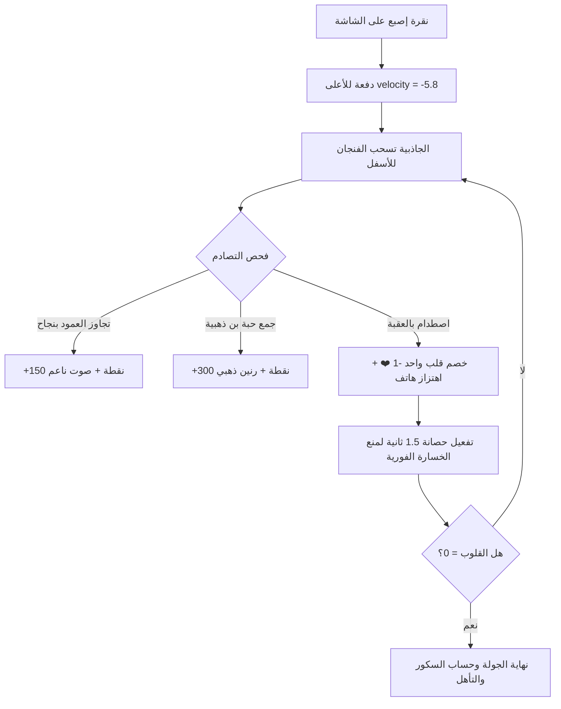

# وثيقة المواصفات الفنية وخطة التنفيذ المعتمدة لمنصة ألعاب كافيه the A&A
**the A&A Specialty Cafe & Sweets — Al-Madinah Al-Munawwarah**  
*وثيقة مفصلة معدة للمراجعة والتدقيق الفني والاستراتيجي — نوفمبر 2026*

---

## 📋 الفهرس العام للوثيقة
1. [الملخص التنفيذي وأهداف التحديث](#1-الملخص-التنفيذي-وأهداف-التحديث)
2. [المحور الأول: مواصفات اللعبة البديلة — "فنجان the A&A الطائر (Barista Glide)"](#2-المحور-الأول-مواصفات-اللعبة-البديلة--فنجان-the-aa-الطائر-barista-glide)
3. [المحور الثاني: نظام شاشات التعليمات السريعة والمبسطة لجميع الألعاب الـ 9](#3-المحور-الثاني-نظام-شاشات-التعليمات-السريعة-والمبسطة-لجميع-الألعاب-الـ-9)
4. [المحور الثالث: هندسة عناصر الأدرينالين والإثارة اللحظية](#4-المحور-الثالث-هندسة-عناصر-الأدرينالين-والإثارة-اللحظية)
5. [المحور الرابع: ثورة الجرافيكس واستبدال الإيموجيات البدائية](#5-المحور-الرابع-ثورة-الجرافيكس-واستبدال-الإيموجيات-البدائية)
6. [المحور الخامس: هندسة النظام الصوتي المحمس والمؤثرات الواقعية](#6-المحور-الخامس-هندسة-النظام-الصوتي-المحمس-والمؤثرات-الواقعية)
7. [المحور السادس: مصفوفة الأمان، منع الاحتيال، والربط مع الكاشير](#7-المحور-السادس-مصفوفة-الأمان-منع-الاحتيال-والربط-مع-الكاشير)
8. [المحور السابع: جدول مصفوفة الاختبارات وخطة التنفيذ الفني](#8-المحور-السابع-جدول-مصفوفة-الاختبارات-وخطة-التنفيذ-الفني)

---

## 1. الملخص التنفيذي وأهداف التحديث

تهدف هذه الخطة إلى تحويل منصة ألعاب **the A&A** في مسار السيارات (Drive-Thru) إلى منتج كاجوال فاخر وخالٍ تماماً من المشاكل التقنية، بالتركيز على 5 ركائز أساسية:
1. **استبدال لعبة السلة:** إزالة لعبة كرة السلة المعقدة فيزيائياً واستبدالها بلعبة **"Barista Glide" (فنجان the A&A الطائر)** المبنية على ميكانيكية Flappy الشهيرة عالمياً لضمان استجابة لمسية سلسة 100% بدون أي عيوب برمجية.
2. **تبسيط التعليمات:** توفير تعليمات مكتوبة من 3 أسطر واضحة ومباشرة بنظرة سريعة (الهدف، كسب النقاط، أسباب الخصم) ليفهم العميل اللعبة في ثانيتين دون ملل.
3. **مضاعفة الأدرينالين والحماس:** إضافة نبضات القلب التفاعلية وتأثير اهتزاز القلوب عند بقاء قلب واحد، مع تفعيل "فورة الثواني الذهبية (Golden Rush 2x)" في آخر 10 ثوانٍ لضخ الحماس ودفع العميل لتحقيق سكور الفوز.
4. **الارتقاء بالجرافيكس:** استبدال الإيموجيات العشوائية برسومات فيكتور SVG دقيقة وأنيقة تعكس هوية the A&A الفاخرة (الأسود، الذهب، الكريما).
5. **معالجة الصوت:** هندسة صوتية جديدة تجمع بين إيقاع المقهى الحيوي الهادئ (Groove) والمؤثرات الواقعية المحفزة غير المزعجة.

---

## 2. المحور الأول: مواصفات اللعبة البديلة — "فنجان the A&A الطائر (Barista Glide)"

### أ. ميكانيكا اللعبة وأسلوب التحكم (Core Mechanics):
- **الرمز التعريفي في النظام:** `id: 'glide'` (يستبدل `basketball` في مصفوفة `GAMES`).
- **العنوان بالواجهة:** **فنجان the A&A الطائر** (En: **Barista Glide**).
- **الشعار التعريفي:** فنجان قهوة ورقي مختص ومذهب يحلق في سماء الكافيه.
- **التحكم باللمس (One-Tap Physics):**
  - كل لمسة/نقرة على الشاشة تمنح الفنجان دفعة للأعلى بقوة محددة (`velocity = -5.8px/frame`).
  - قوة جاذبية ناعمة وثابتة تسحب الفنجان للأسفل تدريجياً (`gravity = +0.28px/frame^2`).
  - الفنجان يميل بزاوية ناعمة تتناسب مع حركته (`tilt: -18deg` عند الصعود، وتصل إلى `+28deg` عند الهبوط).

### ب. العقبات وعناصر جمع النقاط:
- **العقبات (Obstacles):**
  - أعمدة متباعدة تتحرك من اليمين إلى اليسار بسرعة متزايدة مع الوقت.
  - تصميم العقبات يحاكي ديكور the A&A: أعمدة خشبية فاخرة وملاعق تحريك ذهبية ومطاحن قهوة.
  - وجود فتحة أمان واسعة وعادلة بين العمود العلوي والسفلي (Gap Size لا تقل عن 130px لضمان عدم التعجيز).
- **جمع النقاط (Score Collectibles):**
  - تجاوز كل عمود بنجاح يمنح **+150 نقطة**.
  - حبات بن ذهبية طافية بين الأعمدة جمعها يمنح **+300 نقطة إضافية** ومؤثر صوتي رنان.
- **نظام الأمان والقلوب (Fair Damage System):**
  - الاصطدام بعمود أو ملامسة الأرضية يخصم **قلباً واحداً فقط (-1 ❤️)**.
  - **فترة حصانة مؤقتة (1.5s Mercy Window):** بعد الاصطدام، يومض الفنجان بنقاء شفاف (Semi-transparent Flicker) لمدة 1.5 ثانية يكون فيها محصناً من أي تصادم إضافي، لمنع خسارة القلوب الثلاثة دفعة واحدة وضمان تجربة عادلة وممتعة.



---

## 3. المحور الثاني: نظام شاشات التعليمات السريعة والمبسطة لجميع الألعاب الـ 9

وفقاً للتوجيه المعتمد: **التعليمات مكتوبة ببساطة تامة وبدون أي تعقيد، وتتكون من 3 نقاط محددة وسريعة (الهدف، النقاط، الخصم) ليرمي العميل عينه عليها في ثانيتين فقط قبل الضغط على "ابدأ الجولة"**:

### جدول التعليمات السريعة للألعاب الـ 9:

| # | اسم اللعبة | 🎯 الهدف (إيه المطلوب؟) | ⭐ كيف تجمع النقاط؟ | ⚠️ أسباب الخصم (القلوب والنقاط) |
| :-: | :--- | :--- | :--- | :--- |
| **1** | **سرعة الباريستا** *(Reflex Rush)* | اضغط بسرعة على حبات البن الذهبية أول ما تضيء. | كل لمسة سريعة تمنحك +100 نقطة، وسرعتك تضاعف السكور x2 و x3. | تفويت الحبة أو الضغط على حبة محروقة يخصم قلباً ❤️! |
| **2** | **سر النمط** *(Pattern Lock)* | احفظ تتابع إضاءة أكواب the A&A وكرره بنفس الترتيب. | كل نمط تكتشفه وتكمله بنجاح يمنحك +500 نقطة. | أي ضغطة بترتيب غير صحيح تخصم قلباً واحداً ❤️. |
| **3** | **أين حبة البن؟** *(Where Is The Bean)* | راقب الكوب الذي تحته حبة البن الذهبية بعد خلط الأكواب. | اكتشاف الكوب الصحيح يمنحك +400 نقطة ويصعّد المستوى. | اختيار الكوب الفارغ يخصم قلباً واحداً ❤️. |
| **4** | **برج الأكواب** *(Cup Tower)* | المس الشاشة لإسقاط الكوب بدقة فوق البرج المتصاعد. | المحاذاة التامة للبرج تمنحك +250 نقطة (Perfect Stack). | سقوط الكوب خارج البرج يخصم قلباً واحداً ❤️. |
| **5** | **اصطياد البن** *(Catch the Beans)* | حرك السلة يميناً ويساراً لاصطياد حبات البن المتساقطة. | كل حبة تلتقطها = +100 نقطة، والحبات المتتالية ترفع الكومبو. | التقاط حبة فاسدة أو تفويت 3 حبات متتالية يخصم قلباً ❤️. |
| **6** | **فن صب اللاتيه** *(Precision Pour)* | اضغط واستمر بالضغط لملء الكوب، واترك إصبعك في المنطقة الخضراء. | التوقف التام في منتصف المنطقة الخضراء = +500 نقطة ممتازة. | نقص المشروب أو فيضانه خارج الكوب يخصم 200 نقطة وقلباً ❤️. |
| **7** | **نغمات الإسبريسو** *(Rhythm Relay)* | اضغط على الأزرار فور وصول نغمات القهوة لخط التبخير بدقة. | الضغط في التوقيت المثالي يمنحك +200 نقطة مع كومبو مضاعف. | تفويت النغمة أو الضغط المبكر يخصم قلباً واحداً ❤️. |
| **8** | **ذاكرة المقهى** *(Pair Hunt)* | افتح البطاقات المتطابقة لحلويات ومشروبات the A&A. | كل زوج متطابق تكتشفه يمنحك +300 نقطة. | فتح بطاقتين مختلفتين لا يخصم قلوباً ولكنه يضيع الوقت! |
| **9** | **فنجان the A&A الطائر** *(Barista Glide)* | اضغط على الشاشة ليحلق الفنجان بين أعمدة وملاعق الكافيه. | تجاوز كل عمود = +150 نقطة، وجمع حبات البن = +300 نقطة. | الاصطدام بأي عمود أو ملامسة الأرضية يخصم قلباً واحداً ❤️! |

---

## 4. المحور الثالث: هندسة عناصر الأدرينالين والإثارة اللحظية

لتحقيق عنصر الحماس المطلوب، سيتم تطبيق آليتين نفسيتين وبرمجيتين لرفع تركيز اللاعب:

### أ. أدرينالين القلب الأخير (Last Heart Panic):
- **متى يتفعل؟** عندما تنخفض القلوب إلى `hearts === 1`.
- **التأثير البصري المباشر:**
  - ينبض القلب المتبقي في زاوية الشاشة بحركة خفقان سريعة ومضطربة عبر Keyframes مخصصة:
    ```css
    @keyframes heartPanicBeat {
      0%, 100% { transform: scale(1); filter: drop-shadow(0 0 2px #C26A5A); }
      15% { transform: scale(1.35) rotate(-4deg); filter: drop-shadow(0 0 10px #ff3333); }
      30% { transform: scale(1.05) rotate(3deg); }
      45% { transform: scale(1.25) rotate(-2deg); }
    }
    ```
  - يظهر توهج نبضي خافت بلون أحمر دافئ على أطراف الشاشة (Vignette Glow).
- **التأثير الصوتي واللمسي:**
  - صوت نبض قلب عميق بنغمات sub-bass خافتة (*دوم... دوم...* على تردد 55Hz) يتسارع قليلاً مع اللعب.
  - تشغيل اهتزاز الهاتف اللمسي `navigator.vibrate([40, 60, 40])` محاكياً نبضات القلب الحقيقية.

### ب. فورة الثواني الذهبية (Last 10 Seconds Golden Rush 2x):
- **متى تتفعل؟** عند وصول المؤقت إلى `gTime <= 10`.
- **التأثيرات المطبقة:**
  1. **المؤقت المتوهج:** يتحول عداد الثواني للون الذهبي الوهاج بنبضات تكبر وتصغر مع كل ثانية متبقية.
  2. **مضاعف السكور المؤقت (2x Rush):** كل نقطة يحصل عليها اللاعب في هذه الثواني العشر تُحسب مضاعفة (`score += points * 2`)، مما يعطي العميل أملاً قوياً في القفز من 4,000 نقطة إلى 5,000 نقطة قبل انتهاء الوقت!
  3. **شارة التحفيز العلوية:** تنبثق عبارة ذهبية براقة: *"⚡ فورة الثواني الأخيرة: النقاط مضاعفة 2x! حطم سكورك الآن! ⚡"*.
  4. **مؤثر نغمي تصاعدي (Tension Riser):** صوت تكتكة وإيقاع نغمي تصاعدي دافئ يشعل الحماس دون أي ضوضاء حادة.

---

## 5. المحور الرابع: ثورة الجرافيكس واستبدال الإيموجيات البدائية

### أ. مواصفات الأصول البصرية الفيكتورية (SVG Assets Specifications):
بدلاً من نصوص الإيموجي التقليدية لنظام التشغيل، يتم بناء رسومات فيكتور SVG دقيقة مدمجة برمجياً بخفة وسرعة تحميل متناهية (Inline High-Performance SVG):

1. **فنجان the A&A الملكي (Royal Coffee Cup):**
   - تصميم كوب ورقي أسود فاخر بختم اللوجو المذهب، مع لمسات الكريما وأبخرة القهوة المتصاعدة بنعومة.
2. **حبات البن المختصة (Specialty Coffee Beans):**
   - حبات بن مجسمة ثلاثية الأبعاد بظلال وانعكاسات ضوئية دقيقة مع حواف ذهبية تعكس الفخامة.
3. **أدوات الباريستا (Barista Tools):**
   - رسم معدني عالي التباين ليد البورتافلتر (Portafilter) وسيرفرات التقطير الزجاجية الشفافة.
4. **أيقونات التقييم والأوسمة:**
   - نجوم وشارات تتطابق مع هوية الكافيه (Gold Medals & Trophies).

### ب. تحسينات المظهر والـ Micro-Interactions:
- **فيزياء اللمس التفاعلي (Squash & Stretch):** كل عنصر يتم لمسه يتمدد أفقياً بنسبة 8% وينضغط رأسياً بنسبة 5% لمدة 90ms ليعطي إحساساً مطاطياً ولطيفاً باللمس.
- **تناثر الجزيئات الذهبية (Gold Particle Bursts):** عند حصد نقطة أو تسجيل كومبو، تنبثق جزيئات ذهبية دقيقة تتلاشى بنعومة للأعلى.

---

## 6. المحور الخامس: هندسة النظام الصوتي المحمس والمؤثرات الواقعية

### أ. المحرك الصوتي الديناميكي (Dynamic Web Audio Architecture):
1. **نمط المقهى الإيقاعي المحمس (A&A Cafe Groove Theme):**
   - توليد بيز صوتي دافئ متناسق (Warm Acoustic Bass Loop) بنغمات C-Am-F-G هادئة.
   - دمجه بإيقاع دفوف وشيكر ناعم (Sub-bass dum & rim tak) يعطي إحساس المقهى العصري الحيوي.
   - مستوى الصوت مضبوط بنعومة (Gain: 0.15) ليظل خلفية ممتعة لا تطغى على حديث ركاب السيارة.
2. **المؤثرات التفاعلية النقية (Tactile SFX):**
   - **نقرة اللمس:** صوت سيراميك ناعم وخافت.
   - **النجاح والتطابق:** رنين كوردات جيتار أو هارموني بلوري صاعد.
   - **الخطأ:** نقرة مكتومة خافتة (Soft Thud) بدلاً من أي صوت صفير مزعج.
   - **الاحتفال وصرف القسيمة:** هارموني وتر هارب مبهج يرافقه إطلاق الكونفيتي الملون.
3. **التحكم وحفظ الإعدادات:**
   - زر كتم الصوت وأزرار تبديل النمط محفوظة تلقائياً في `localStorage` ولا تعود للعمل إذا فضل العميل كتمها.

---

## 7. المحور السادس: مصفوفة الأمان، منع الاحتيال، والربط مع الكاشير

لضمان عدم حدوث أي ثغرات عند إضافة لعبة **Barista Glide** والتعديلات الجديدة:
1. **شهادة اللعب المشفرة (Cryptographic Run Certificate):**
   - اللعبة تسجل إحداثيات القفزات وتوقيت البداية والنهاية في شهادة مشفرة `runCert` موقعة بـ HMAC Salt.
   - مستحيل توليد سكور مؤهل للكوبون دون خوض ثواني اللعبة فعلياً.
2. **حماية القسائم في المحفظة الدائمة:**
   - القسيمة تُحفظ في `the_aa_cafe_vouchers_wallet` وتصمد لـ 3 أيام كاملة (72 ساعة).
   - ريست السكور اليومي في منتصف الليل يصفر نقاط المنافسة فقط ويحافظ على القسيمة صالحة كما هي.
3. **تكامل شاشة الكاشير ([staff.html](file:///c:/Users/sam20/cafe_game/staff.html)):**
   - التحقق الفوري من كود القسيمة بنظام منع الصرف المزدوج (Idempotency Check).
   - إدراج القسيمة السابقة تلقائياً في `revokedCodes` عند ترقية العميل لكوبونه لنفس اليوم.

---

## 8. المحور السابع: جدول مصفوفة الاختبارات وخطة التنفيذ الفني

### أ. مصفوفة التحقق والاختبار (309+ اختبار):
فور بدء التنفيذ، ستخضع كافة التعديلات لـ 4 أجنحة اختبارات مؤتمتة:
1. `test_platform.js`: اختبار سلامة بنية الكود، الألعاب الـ 9، وتكامل اللغات.
2. `test_new_15_requirements.js`: التحقق من الـ 15 متطلباً الأساسياً للعميل.
3. `test_all_user_scenarios.js`: اختبار مسار العميل من البداية وحتى صرف الكاشير.
4. `test_40_comprehensive_scenarios.js`: اختبار 40 سيناريو اختراق، تلاعب، ومحاولات غش للعبة الجديدة والتعليمات.

### ب. خطة التنفيذ الممنهجة (Execution Phases):

```
المرحلة 1: بناء لعبة Barista Glide واستبدال لعبة السلة
├─ برمجة ميكانيكا الطيران السلسة (Flap Impulse & Smooth Gravity)
├─ تصميم العقبات وملاعق الكافيه وحبات البن الذهبية
└─ اختبار صندوق التصادم وفترة الحصانة المؤقتة (1.5s Mercy Window)

المرحلة 2: شاشات التعليمات النصية السريعة (3 أسطر لكل لعبة)
├─ كتابة نصوص التعليمات المباشرة لجميع الألعاب الـ 9
└─ تصميم واجهة العرض السريعة في شاشة #pre لتقرأ في ثانيتين

المرحلة 3: هندسة أدرينالين القلب الأخير وفورة الثواني الذهبية
├─ نبض واهتزاز القلب الأخير (Heartbeat Animation & Sound)
└─ تفعيل مضاعف النقاط 2x وتوهج المؤقت في آخر 10 ثوانٍ

المرحلة 4: استبدال الإيموجيات برسومات الفيكتور SVG وتطوير الصوت
├─ حقن رسومات الـ SVG المخصصة لكافيه the A&A
└─ ضبط طبقات الصوت الموسيقية والمؤثرات التفاعلية الدافئة

المرحلة 5: التدقيق الشامل وتشغيل الـ 309 اختبار
├─ تشغيل كافة الاختبارات المؤتمتة والتأكد من نجاحها 100%
└─ المراجعة الختامية لملفات index.html و staff.html
```

---
*هذه الوثيقة معتمدة ومحفوظة في جذر المشروع تحت اسم [AA_GAMES_MASTER_EXECUTION_PLAN.md](file:///c:/Users/sam20/cafe_game/AA_GAMES_MASTER_EXECUTION_PLAN.md) وجاهزة للعرض على أي خبير للمراجعة والاعتماد.*

