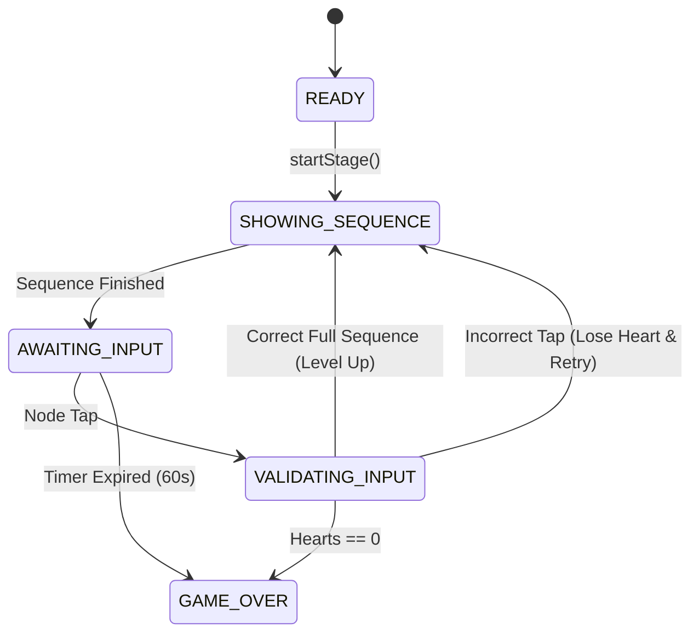

# A&A Cafe Games — Game Replacement Report (Deliverable B)

## 1. Overview of Lineup Transformation

The A&A Cafe Games platform underwent a complete structural realignment to replace two outdated, exploit-prone games with modern, responsive skill-based experiences while maintaining exactly five active, production-ready games.

### 1.1 Retirement of "Hot or Cold" (`sort`)
- **Reason for Retirement**: The legacy "Hot or Cold" game involved classifying menu drinks as hot or cold. Once a customer memorized the fixed drink list, the game ceased to offer any challenge. The binary decision format encouraged blind clicking and lacked reaction-based excitement.
- **Retirement Mechanism**:
  - The game configuration object `{ id: 'sort', ... }` was removed from the active `GAMES` array.
  - The game card was removed from the primary selection grid (`#grid`).
  - All navigation routes, pre-game modals, and event listeners for `sort` were decoupled.
  - Drink asset data remains available in the codebase for potential branding reference, but is not accessible in normal gameplay.

### 1.2 Retirement of "Coffee and City Quiz" (`quiz`)
- **Reason for Retirement**: The trivia quiz relied on static questions about Al-Madinah and coffee brewing. Players quickly learned the correct answer positions (A, B, C), resulting in inflated scores without demonstrating manual dexterity or real-time focus.
- **Retirement Mechanism**:
  - The game configuration object `{ id: 'quiz', ... }` was removed from the active `GAMES` array.
  - Quiz screen elements, option buttons, and answer reveal timers were completely decommissioned from gameplay navigation.
  - No orphaned quiz routes or question screens remain reachable in the user flow.

---

## 2. New Game One: Reflex Rush (`reflex` - ردة الفعل السريعة)

### 2.1 Product Concept & Player Fantasy
Reflex Rush is a high-octane reaction and accuracy mini-game designed specifically for mobile and desktop screens. Targets dynamically spawn across the play area. Players must tap golden targets as quickly as possible while avoiding penalty targets and ignoring decoys.

### 2.2 Gameplay Loop
1. **Introduction**: Pre-game screen explains target types and displays chosen difficulty.
2. **Start & Session Init**: 60-second countdown begins; HUD displays score, level, combo, and 3 hearts.
3. **Spawn Loop**: Targets spawn at variable coordinates within safe viewport boundaries (padding of `size + 16px` to prevent edge overlap or HUD obstruction).
4. **Interaction Handling**:
   - **Golden Target (`gold`)**: Awards points scaled by reaction speed (monotonically measured via `performance.now()`), current combo, level multiplier, and difficulty multiplier.
   - **Burnt Target (`burnt` - ✕)**: Hazard target. Touching it deducts 1 heart (`c.loseHeart()`), breaks combo, and imposes a score penalty (-35 pts).
   - **Decoy Target (`decoy`)**: Neutral element.
   - **Blank Screen Tap**: Tapping empty space triggers `c.miss()` to penalize blind screen-mashing.
5. **Target Expiration**: Golden targets fade with an expiring animation; if missed, they deduct a minor penalty and reset combo.
6. **Game Over / Completion**: Ends when the 60-second timer reaches 0 or when hearts reach 0.

### 2.3 Mathematical Scoring Formula
For a valid hit on target $i$:
$$\text{Points} = \max\left(5, \text{round}\left(\frac{\text{basePoints} \times \text{weight} \times L \times C \times D \times W_{\text{speed}}}{5}\right) \times 5\right)$$
Where:
- $\text{basePoints} = 18$
- $\text{weight} = 1.5$ (Reflex Rush weight)
- $L = 1 + 0.15 \times (\text{level} - 1)$
- $C = 1 + \min(\text{combo} - 1, 8) \times 0.1$
- $D = \text{Difficulty Multiplier}$ (Easy: $1.0$, Medium: $1.2$, Hard: $1.4$)
- $W_{\text{speed}} = 1.0 + \max(0, (1 - \text{elapsed}/\text{lifetime}) \times 0.8)$ (up to $1.8\times$ for instant reflex taps).

### 2.4 Acceptance Criteria Verification
- [x] Targets cannot award duplicate points (immediate DOM detachment and removal from `activeTargets` map).
- [x] Expired targets cannot be scored.
- [x] Hazard taps trigger visual feedback, audio warning, and deduct exactly one heart.
- [x] Screen spamming triggers empty-click penalties.

---

## 3. New Game Two: Pattern Lock (`pattern` - نمط القفل السري)

### 3.1 Product Concept & Player Fantasy
Pattern Lock is a visual sequence memory and recall game inspired by smartphone security patterns and Madinah architectural geometry. A $3 \times 3$ grid of coffee-bean nodes lights up in a specific sequence with distinct audio-visual pulses. The player must reproduce the pattern in exact order.

### 3.2 Formal State Machine
The game operates under an explicit, robust state machine:

1. **`READY`**: Stage elements initialized.
2. **`SHOWING_SEQUENCE`**: Grid interaction disabled (`pointerEvents: none`). Node sequence is illuminated step-by-step with synchronized Web Audio tones.
3. **`AWAITING_INPUT`**: Grid interaction enabled (`pointerEvents: auto`). Awaiting player taps.
4. **`VALIDATING_INPUT`**: Compares player tap against `expected = currentSequence[userInput.length]`.
   - If correct: Node flashes green, plays harmonic tone. If full sequence reached: awards combo bonus points and advances to next stage ($N + 1$ length).
   - If incorrect: Node flashes red, plays dissonance buzz, deducts 1 heart (`c.loseHeart()`), and re-shows sequence after a 1100ms pause.
5. **`GAME_OVER`**: When timer expires or hearts reach 0.

### 3.3 Sequence Generation & Fair Play
- Generated using cryptographically sound random indices ($0$ to $8$):
  - Prevents immediate self-repetition ($A \neq B$).
  - Sequence length scales gradually: $\text{length} = \min(8, 2 + \text{stageLevel})$.
  - Sequence values are kept in internal JavaScript closure memory and are **not** exposed in DOM data attributes or readable HTML attributes, preventing easy client inspection exploits.

### 3.4 Acceptance Criteria Verification
- [x] User input blocked completely during `SHOWING_SEQUENCE` demonstration phase.
- [x] Out-of-order taps immediately flagged as failure.
- [x] Duplicate rapid clicks on the same node do not bypass sequence validation.
- [x] Hearts deduct accurately upon error and terminate game cleanly at 0.

---

## 4. Final Five-Game Lineup Inventory

| # | Game ID | User-Facing Name | Emoji | Role & Status | Scoring Weight | Primary Skill Required |
| :-: | :---: | :--- | :-: | :--- | :-: | :--- |
| **1** | `reflex` | **ردة الفعل السريعة** (Reflex Rush) | ⚡ | **NEW Replacement** | 1.5× | Hand-eye reaction speed & target discrimination |
| **2** | `pattern` | **نمط القفل السري** (Pattern Lock) | 🔐 | **NEW Replacement** | 2.5× | Short-term spatial and sequence memory |
| **3** | `shuffle` | **أين الحبة؟** (Where Is the Ball?) | 🥤 | **Retained & Balanced** | 3.2× | Visual tracking and concentration |
| **4** | `stack` | **برج الكوبايات** (Cup Tower) | 🏗️ | **Retained & Balanced** | 1.6× | Timing and spatial alignment accuracy |
| **5** | `beans` | **اصطياد الحبوب** (Catch the Beans) | ☕ | **Retained & Balanced** | 1.3× | Continuous steering and hazard avoidance |

---

## 5. Shared Infrastructure & Legacy Code Strategy
- **Shared Architecture**:
  - All 5 games execute within the unified `makeCtx(g, stage, onEnd)` execution harness.
  - Universal HUD: Score, Timer (60s), Level chip (1 to 4), Hearts (`❤️❤️❤️`), Combo indicator.
  - Universal sound synthesizer: `SFX` module utilizing dynamic Web Audio API.
  - Universal difficulty scaling: `c.diffMultiplier()` injected into all 5 games.
- **Retired Games Disposal**:
  - `sort`, `quiz`, `bubbles`, `memory`, `simon`, `pour` are no longer registered in `GAMES`.
  - No DOM elements or routes link to retired games.
  - Shared CSS utilities (`.wrap`, `.hud`, `.btn`) remain clean and modular.
