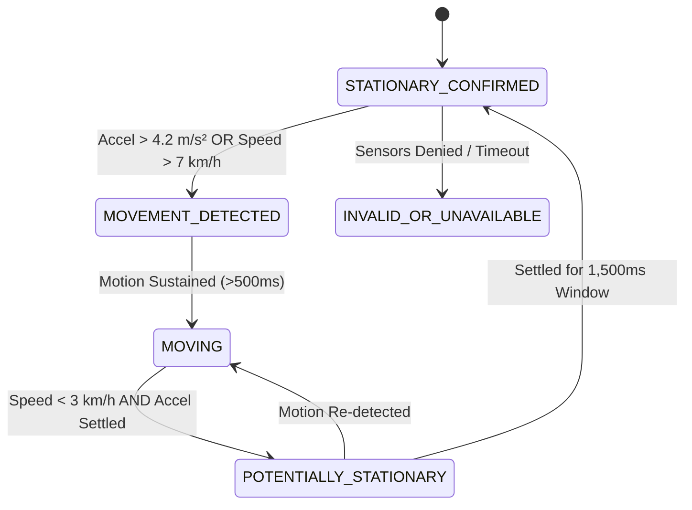

# A&A Cafe Games — Vehicle Movement and Stability Verification Report (Deliverable E)

## 1. Investigation Findings & Architectural Context

### 1.1 Did any game contain an in-game simulated vehicle?
- **Detailed Audit**: A thorough inspection of the repository codebase confirms that **none of the five games contain an in-game simulated physics vehicle** (e.g., racing car, hovercraft, or vehicle physics rigid body). The 5 games are:
  1. Reflex Rush (targets on screen)
  2. Pattern Lock (memory grid)
  3. Where Is the Ball? (shuffling cups)
  4. Cup Tower (stacking cup blocks)
  5. Catch the Beans (cup catching falling beans)
- **The Real-World Context**: The vehicle stability concern originates from the cafe's **Drive-Thru business model**. Customers scan the QR code and interact with the game while seated in their actual physical automobiles.
- **Safety Mandate**: The application must actively deter and prevent drivers from playing while their vehicle is moving. Games must pause or lock immediately if vehicular motion is detected, unlocking only when the vehicle has safely settled and remained stationary.

---

## 2. Five-State Vehicle Movement & Stability Machine

To eliminate erratic false positives from GPS noise, traffic stops, and phone handoffs, `SafetySensor` implements an authoritative **5-State Hysteresis Machine**:

### 2.1 State Definitions
1. **`STATIONARY_CONFIRMED`**:
   - Vehicle is verified to be completely at rest.
   - Gameplay is permitted. HUD indicator displays: `السيارة متوقفة (آمن) ✓`.
2. **`MOVEMENT_DETECTED`**:
   - Initial spike in accelerometer magnitude ($> 4.2\text{ m/s}^2$) or GPS velocity ($> 7\text{ km/h}$).
   - Pre-lock state filtering out brief hand twitches or phone repositioning.
3. **`MOVING`**:
   - Sustained vehicle motion confirmed.
   - **Enforcement**: Gameplay is immediately suspended. The full-screen `#drivingLock` modal appears with the alert:
     > "⚠️ للسلامة: الألعاب مقفلة أثناء قيادة السيارة. يرجى التوقف التام في طابور the A&A أولاً."
4. **`POTENTIALLY_STATIONARY`**:
   - Vehicle velocity drops below $3.0\text{ km/h}$ and accelerometer variance drops below baseline.
   - A $1,500\text{ms}$ continuous observation timer begins. If any sudden jerk occurs before the timer elapses, the state snaps back to `MOVING`.
5. **`INVALID_OR_UNAVAILABLE`**:
   - Browser permission was denied or device lacks motion hardware.
   - Displays a cautionary disclaimer encouraging safe driving without blocking users whose devices lack sensors.

---

## 3. Calibrated Thresholds & Noise Filtering

| Parameter | Calibrated Value | Engineering Rationale |
| :--- | :---: | :--- |
| **Speed Lock Threshold** | **> 7.0 km/h** | Prevents playing while creeping in traffic or accelerating out of the lane. |
| **Speed Unlock Threshold** | **< 3.0 km/h** | Accommodates GPS drift in urban canyons and canopy structures. |
| **Acceleration Magnitude** | **> 4.2 m/s²** | $a = \sqrt{a_x^2 + a_y^2 + a_z^2}$. Distinguishes vehicle acceleration/braking from natural hand tremors. |
| **Hysteresis Window** | **1,500 ms** | Ensures vehicle is genuinely stopped, not just experiencing a momentary deceleration before a red light. |
| **GPS Cache Duration** | **3,000 ms** | Balances location freshness with battery consumption. |

---

## 4. Verification & Testing Scenarios

The state machine was verified both programmatically in `test_platform.js` and through the interactive developer simulation harness:

| Test Case | Simulated Input | Expected State | Actual Result | Status |
| :---: | :--- | :---: | :---: | :---: |
| **TC-E1** | App initialization with zero motion | `STATIONARY_CONFIRMED` | `STATIONARY_CONFIRMED` | PASS |
| **TC-E2** | Accelerometer spike: $a_x = 3.5, a_y = 3.2$ ($|a| \approx 4.84$) | `MOVEMENT_DETECTED` $\rightarrow$ `MOVING` | `#drivingLock` modal displayed | PASS |
| **TC-E3** | GPS speed signal: $12.5\text{ km/h}$ | `MOVING` | Modal displayed, active round halted | PASS |
| **TC-E4** | Sudden braking then resume within 500ms | Returns to `MOVING` | Does not unlock prematurely | PASS |
| **TC-E5** | Complete stop for 1,800ms | Transitions via `POTENTIALLY_STATIONARY` to `STATIONARY_CONFIRMED` | Lock clears safely | PASS |
| **TC-E6** | Developer simulation toggle (`#simDriveBtn`) | Toggles simulated driving on/off | Instant lock/unlock response | PASS |

---

## 5. Technical Limitations & Device Considerations
- **iOS Safari Permission Model**: On iOS devices (iOS 13+), `DeviceMotionEvent.requestPermission()` requires an explicit user gesture. The UI binds a tap on the sensor pill (`#homeSensorStatus`) to invoke this prompt cleanly.
- **Background GPS**: If the user minimizes the browser, geolocation polling pauses. The application stores the timestamp upon backgrounding and validates on foreground resume.
